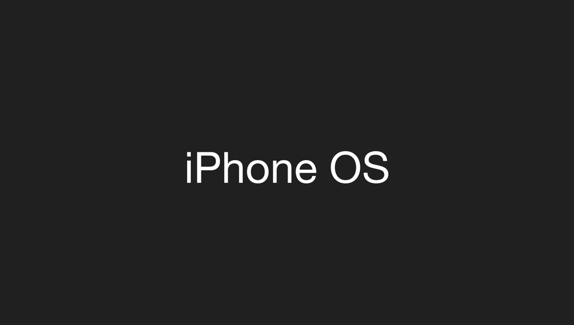

<h1 align="center">
  <br>
  Skater Nation · PS Vita Port
</h1>

<p align="center">
  <a href="#status">Status</a> •
  <a href="#active-issue">Active Issue</a> •
  <a href="#installation-players">Installation</a> •
  <a href="#controls">Controls</a> •
  <a href="#building-developers">Building</a> •
  <a href="#loader-architecture">Architecture</a>
</p>

An unofficial native port of *Skater Nation* (Gameloft, iOS 1.2.1) to the PlayStation Vita. There is no `.so` here. The port ships its own **Mach-O loader**, which maps the original iOS ARM executable (`SkateNation`) into Vita RAM and replaces the Apple frameworks it uses (Foundation, UIKit, OpenGL ES, CoreAudio/OpenAL) with native implementations built on **vitaGL**, **OpenAL Soft**, **FreeType** and the Vita system libraries. The game engine (**Irrlicht**, plus **gameswf** for the Flash UI) runs unmodified.

The runtime was adopted from [`Zombie-Infection-vita`](../Zombie-Infection-vita), a port from the same Gameloft/Irrlicht lineage.

---

## Status

**Status: BLOCKED (regression).** Commit `7e6ebbe` was playable. Since `297e1cc` (16:9 fullscreen + HUD opacity), the game crashes during startup or level loading. See [Active Issue](#active-issue).

- [x] **Mach-O loader**: fixed base `MACHO_SLIDE = 0x98000000`, **60,307** rebase words, **8,796** import slots (24 unimplemented), **142** global constructors. *Verified on console.*
- [x] **Graphics**: GLES 1.x → vitaGL (`SOFTFP_ABI=1`). The game draws into a 320×480 portrait FBO that is rotated and scaled to 960×544. *Verified on console (7e6ebbe).*
- [x] **Touch & physical controls**: buttons and sticks inject synthetic touches on the game's own HUD. *Verified on console (7e6ebbe).*
- [x] **Camera**: the right stick orbits the camera. Sensitivity (1–10) is saved to `ux0:data/skaternation/camera_sens.txt`.
- [ ] **16:9 fullscreen without stretching**: temporarily reverted to the 7e6ebbe 3:2 pillarbox while the crash is bisected (it landed together with the regression).
- [~] **1% opacity on the joystick and A/B buttons**: via `gameswf::character::set_member("_alpha")`. Implemented, not yet verified.
- [ ] **Audio**: OpenAL → openal-soft. **Temporarily paused** (`AUDIO_ENABLED 0` in `source/coreaudio.c`) while the crash is isolated.

---

## Active Issue

**Guest code reads uninitialized heap memory** (runs 22–28).

| | |
|---|---|
| Latest crash (run 28) | `Application::LoadOrientationStyle` → `SetStatusBarOrientation(bool)+264` loads a pointer from `WorldManager + 0x4528`, gets garbage (`0x1a000003`) and faults. |
| Root cause | `WorldManager` is allocated with `operator new(0x46d0)`, and its constructor never initializes `+0x4528`. On iOS, fresh heap memory is zero-filled; newlib returns leftover data. The game silently relies on zeroed memory. |
| Why the crash kept "moving" | Where garbage lands depends on heap layout, so unrelated changes (widescreen, HUD, audio) moved the fault around. Runs 22–27 hit `SceGxm seg1 + 0xa548` (`sceGxmSetViewport` after a failed `sceGxmBeginScene`) during level loading. That is likely the same root cause. |
| Fixed (run 29) | Guest `operator new`/`new[]` (`source/cxx.c`) and `malloc` (`source/darwin.c`) now return zero-filled memory (`calloc`). This removed the `WorldManager` crash. |
| Still open | The SceGxm crash during level loading (`gles_present → glClear`). Run 30 showed that no GXM scene call fails. Run 31 bisects by restoring the 7e6ebbe graphics path, so 16:9 fullscreen is temporarily off (3:2 pillarbox). |
| Already ruled out | r9 clobbering (the loader is built with `-ffixed-r9`), vitaGL tile clipper, scenes per frame, audio, HUD opacity. |
| Still pending | Re-enable audio once loading is stable. If the SceGxm crash persists, bisect the `7e6ebbe → 297e1cc` delta (`wide_begin` projection, HUD opacity, scissor). |

Per-run history: [`port_progress.md`](port_progress.md). Release status: [`RELEASE.md`](RELEASE.md).

---

## Disclaimer

*Skater Nation* is a registered trademark of **Gameloft**. This project is unofficial and is not endorsed by Gameloft. The repository contains **no** game code, binaries or assets (see `.gitignore`). To play, you need your own legally obtained, **decrypted** copy of the `.ipa`.

---

## Installation (players)

1. **CFW**: Enso 3.60/3.65 with `kubridge` enabled:
   ```ini
   *KERNEL
   ur0:tai/kubridge.skprx
   ```
2. **Shader compiler**: `libshacccg.suprx` in `ur0:data/` (extract it with ShaRKBR33D).
3. **Game files**: a decrypted *Skater Nation* **1.2.1** `.ipa` (FairPlay `cryptid 0`). Open it as a ZIP and extract `Payload/SkateNation.app/`.
4. **Copy to the Vita**:
   ```
   ux0:data/skaternation/
     SkateNation.app/   the .app folder from the IPA, untouched
     rebase.bin         generated with tools/macho_prep.py (see Building)
     saves/             created automatically: save games (iOS Documents/)
     logs/              created automatically: log_001.log … log_999.log, one per run
   ```
5. **Install** `skaternation.vpk` with VitaShell.

---

## Controls

| Input | Action |
| :---: | :--- |
| **Touchscreen** | Full touch UI (menus and HUD) |
| **Left stick / D-Pad** | Virtual joystick (steering) |
| **Right stick** | Camera orbit |
| **Cross (✖) / R** | Button A: ollie / jump / confirm |
| **Square (◼) / Circle (●) / L** | Button B: grind / trick |
| **Triangle (▲)** | Trick modifier |
| **Start** | Pause / menu |
| **Select** | Map / objectives |
| **Select + D-Pad ↑/↓** | Camera sensitivity 1–10 (saved) |
| **L + R together** | Toggle joystick and A/B button opacity between 1% and 100% |

---

## Building (developers)

Requirements: VitaSDK (`$VITASDK`), CMake ≥ 3.14 and Python 3. vitaGL is vendored in `vendor/vitaGL` and CMake builds it automatically with `SOFTFP_ABI=1`.

```bash
# rebase.bin from the decrypted executable
python3 -I tools/macho_prep.py game_app/SkateNation ux0_data/skaternation/rebase.bin \
    --report docs/macho_report.txt

# Build (Debug enables DEBUG_LOADER: l_debug logs, e.g. every fopen)
psvita-toolkit build            # or: cmake -B build && cmake --build build

# Deploy over FTP (VitaShell at 192.168.3.15:1337)
psvita-toolkit deploy

# Analyze a crash dump
psvita-toolkit analyze logs/<dump>.psp2dmp
```

To resolve guest addresses found in a dump (guest base `0x98000000`):

```bash
atos -arch armv6 -o game_app/SkateNation -l 0 0x<address - 0x98000000>
otool -Iv game_app/SkateNation | grep 0x<stub>   # which import a stub is
```

Project rules (see `CLAUDE.md`): **one bug per console run, driven by logs**; nothing from the IPA goes into git.

---

## Loader Architecture

| File | Role |
|---|---|
| `source/macho.c`, `source/asm.S` | Mach-O loading, rebase, imports and thunks. `call_guest`/`call_guest6` preserve r9; `ml_align_call` realigns the stack to 8 bytes. |
| `source/darwin.c`, `source/darwin_printf.c` | Darwin libc/libgcc/pthread/semaphores (zero-filled `malloc`); printf with unaligned doubles and `%@`. |
| `source/objc.c`, `source/objc_rt.h` | ObjC 2.0 runtime: dispatch to the game's classes plus host Foundation. |
| `source/uikit.c` | `UIApplicationMain` (emulated nib), run loop, `NSTimer`, touches → `UITouch`. |
| `source/gles.c` | GLES1 → vitaGL, 320×480 FBO → 960×544, widescreen (`wide_begin`), `GL_FIXED` conversion; `glFlush` is a no-op. |
| `source/cgbi.c` | Apple CgBI PNG decoder. |
| `source/coreaudio.c` | OpenAL → openal-soft; AudioUnit RemoteIO and AudioSession. `AUDIO_ENABLED` switch. |
| `source/cxx.c` | libstdc++ imports bound to VitaSDK's libstdc++ (COW ABI); zero-filled `operator new`. |
| `source/input.c`, `source/patch.c` | Touch and buttons; synthetic touch mapping, camera and HUD opacity. |
| `source/log.c` | File log flushed on every line (`ux0:data/skaternation/logs/`). |

### iOS → Vita ABI rules

1. **r9 is scratch on iOS**: the loader is built with `-ffixed-r9`, and every call into the game goes through `call_guest`.
2. **softfp**: floats and doubles travel in integer registers, and vitaGL is built with `SOFTFP_ABI=1`. iOS does **not** align doubles to an even register pair: `as_value(double)` takes it in r1:r2.
3. **4-byte stack alignment on iOS**: every import enters through `ml_align_call`.
4. **Zero-filled heap**: iOS game code assumes fresh allocations are zeroed, so guest `malloc`/`new` use `calloc`.
5. **FairPlay**: the executable must be decrypted (`cryptid 0`).
