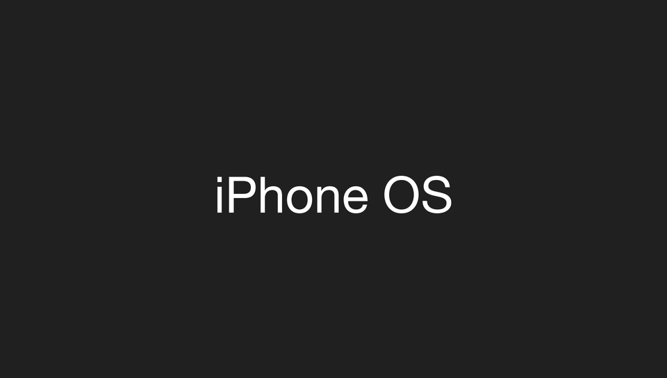

<h1 align="center">
  <br>
  Skater Nation · PS Vita Port
</h1>

<p align="center">
  <b>Native port of Skater Nation (Gameloft) for PlayStation Vita and PlayStation TV.</b>
</p>

<p align="center">
  
  
  
  
  
  
</p>

<p align="center">
  <a href="#-description">Description</a> •
  <a href="#-features">Features</a> •
  <a href="#-controls">Controls</a> •
  <a href="#-installation">Installation</a> •
  <a href="#-known-issues">Known Issues</a> •
  <a href="#-building-from-source">Build</a> •
  <a href="#-credits">Credits</a>
</p>

---

## 📖 Description

An unofficial native port of *Skater Nation* (Gameloft, iOS 1.2.1) to the PlayStation Vita. There is no `.so` here.
The port ships its own **Mach-O loader**, which maps the original iOS ARM executable (`SkateNation`) into Vita RAM and
replaces the Apple frameworks it uses (Foundation, UIKit, OpenGL ES, CoreAudio / OpenAL) with native implementations built
on **vitaGL**, **OpenAL Soft**, **FreeType** and the Vita system libraries. The game engine (**Irrlicht**, plus **gameswf**
for the Flash UI) runs unmodified.

The runtime was adopted from the Zombie-Infection-vita port, a port from the same Gameloft / Irrlicht lineage.

### Gameplay

*Skater Nation* is Gameloft's 3D skateboarding game. You ride open street levels, chain ollies, grinds and tricks into
combos, complete challenges, and unlock skaters and board parts (decks, trucks and wheels).

### Loader architecture

| File | Role |
|---|---|
| `source/macho.c`, `source/asm.S` | Mach-O loading, rebase, imports and thunks. `call_guest` / `call_guest6` preserve r9; `ml_align_call` realigns the stack to 8 bytes. |
| `source/darwin.c`, `source/darwin_printf.c` | Darwin libc / libgcc / pthread / semaphores (zero-filled `malloc`); printf with unaligned doubles and `%@`. |
| `source/objc.c`, `source/objc_rt.h` | ObjC 2.0 runtime: dispatch to the game's classes plus host Foundation. |
| `source/uikit.c` | `UIApplicationMain` (emulated nib), run loop, `NSTimer`, touches → `UITouch`. |
| `source/gles.c` | GLES1 → vitaGL, 320×480 FBO stretched to 960×544, `GL_FIXED` conversion, 5 s `perf:` log line, GXM error hook. |
| `source/cgbi.c` | Apple CgBI PNG decoder. |
| `source/coreaudio.c` | OpenAL → openal-soft; AudioUnit RemoteIO and AudioSession. `AUDIO_ENABLED` switch. |
| `source/cxx.c` | libstdc++ imports bound to VitaSDK's libstdc++ (COW ABI); zero-filled `operator new`. |
| `source/input.c`, `source/patch.c` | Touch (`x*480/960`) and buttons; synthetic touch mapping, camera and HUD opacity (offsets from `HudMenu::Init`). |
| `source/log.c` | File log flushed on every line (`ux0:data/skaternation/logs/`). |

#### iOS → Vita ABI rules

1. **r9 is scratch on iOS**: the loader is built with `-ffixed-r9`, and every call into the game goes through `call_guest`.
2. **softfp**: floats and doubles travel in integer registers, and vitaGL is built with `SOFTFP_ABI=1`. iOS does **not** align
   doubles to an even register pair: `as_value(double)` takes it in r1:r2.
3. **4-byte stack alignment on iOS**: every import enters through `ml_align_call`.
4. **Zero-filled heap**: iOS game code assumes fresh allocations are zeroed, so guest `malloc` / `new` use `calloc`.
5. **FairPlay**: the executable must be decrypted (`cryptid 0`).

---

## 🎮 Status & Playability

**Status: Playable (beta).** The SceGxm loading crash is fixed (run 31). Gameplay runs at 25–28 FPS in fullscreen
with audio (run 33). See [`RELEASE.md`](RELEASE.md) for the GitHub release notes and installation instructions.

<p align="center">
  
</p>

- [x] **Mach-O loader**: fixed base `MACHO_SLIDE = 0x98000000`, **60,307** rebase words, **8,796** import slots (24 unimplemented),
  **142** global constructors. *Verified on console.*
- [x] **Graphics**: GLES 1.x → vitaGL (`SOFTFP_ABI=1`). The game draws into a 320×480 portrait FBO, which is rotated and
  stretched to fill all 960×544 with no black bars, the same method as the Blades of Fury port. *Verified on console.*
- [x] **Touch & physical controls**: buttons and sticks inject synthetic touches on the game's own HUD. *Verified on console.*
- [x] **Camera**: the right stick orbits the camera. Sensitivity (1–10) is saved to `ux0:data/skaternation/camera_sens.txt`.
- [x] **Audio**: OpenAL → openal-soft, re-enabled (`AUDIO_ENABLED 1`). Music and sound effects verified on console.
- [x] **HUD opacity**: joystick and A/B buttons at 1% opacity via `gameswf::character::set_member("_alpha")`. Toggle with L+R.
  *Verified on console.*

### Performance

- **Gameplay**: 25–28 FPS, with `drawView` capped at 30 FPS. `gles_present` writes `perf: N fps, frame X ms, swap Y ms` to the log
  every 5 s. Swap takes 0.1–0.3 ms, so the frame time is CPU-bound (the game itself), not GPU-bound.
- **Loading**: 0.6–3 FPS while a level loads.
- **Logging**: each log line is flushed to `ux0:` (about 10 ms). Nothing is logged per frame in Release. Debug builds
  (`DEBUG_LOADER`) log every `fopen` and are noticeably slower.

### Resolved: SceGxm crash during level loading (runs 22–31)

The crash was an abort in `SceGxm seg1 + 0xa548` (`gles_present → glClear → scene_reset`). It was caused by the widescreen
graphics path added in `297e1cc`. Restoring the `7e6ebbe` path fixed it. Along the way, a heap-garbage crash
(`WorldManager + 0x4528` never initialized) was fixed by making guest `malloc` / `operator new` return zero-filled memory, as iOS does.

Per-run history (in Spanish): [`port_progress.md`](port_progress.md). Release status: [`RELEASE.md`](RELEASE.md).

### Changelog

- **v0.1-beta**: first public beta (`RELEASE.md`). Title ID `PSVSN0001`, base game iOS 1.2.1, status Playable / In-Game 3D,
  25–28 FPS, fullscreen.

---

## ✨ Features

| Feature | Status | Notes |
| :--- | :---: | :--- |
| Boots to gameplay | ✅ | Menus and gameplay on console (verified on console). |
| Graphics / renderer | ✅ | GLES 1.x → vitaGL, 320×480 FBO stretched to 960×544 fullscreen (verified on console). |
| Audio & music | ✅ | OpenAL → openal-soft; music and sound effects verified on console. |
| Video / cutscenes | ❔ <!-- TODO --> | Not documented in this repo. |
| Physical buttons | ✅ | Buttons inject synthetic touches on the HUD (verified on console). |
| Analog sticks / camera | 🧪 | Left stick steers; right stick orbits the camera (sensitivity saved). Camera not separately verified. |
| Touch screen | ✅ | Full touch UI for menus and HUD (verified on console). |
| Button remapping / port menu | 🧪 | Options menu (SELECT + START) is new and not tested on console yet. |
| Save data | 🧪 | `saves/` folder for save games (iOS `Documents/`); <!-- TODO: confirm persistence -->. |
| Native trophies | ❌ | Not documented in this repo. |
| Languages | ❔ <!-- TODO --> | Not documented in this repo. |
| Performance | ✅ | 25–28 FPS in gameplay, fullscreen with audio (console run 33). |
| Online / IAP / ads | ➖ | Not documented in this repo. |
| PS TV | 🧪 | Same VPK; not tested on PS TV. |

Legend: `✅ Working (verified on console) · 🧪 Implemented, not yet verified on console · 🟡 Partial · ❌ Not working · ➖ Not applicable · ❔ Not documented yet`

---

## 🎯 Controls

| Input | Action |
| :---: | :--- |
| **Touchscreen** | Full touch UI (menus and HUD) |
| **Left stick / D-Pad** | Virtual joystick (steering) |
| **Right stick** | Camera orbit |
| **Cross (✖) / R** | Button A: ollie / jump / confirm |
| **Square (◼) / Circle (●) / L** | Button B: grind / trick |
| **Triangle (▲)** | Trick modifier |
| **Start** | Pause / menu |
| **Select** | Map / objectives |
| **Select + D-Pad ↑/↓** | Camera sensitivity 1–10 (saved) |
| **L + R together** | Toggle joystick and A/B button opacity between 1% and 100% |
| **Select + Start** | Options menu (see Options) |

---

## 📋 Prerequisites

1. **CFW**: Enso 3.60 / 3.65 with `kubridge` enabled:
   ```ini
   *KERNEL
   ur0:tai/kubridge.skprx
   ```
2. **Shader compiler**: `libshacccg.suprx` in `ur0:data/` (extract it with ShaRKBR33D).
3. **Game files**: a decrypted *Skater Nation* **1.2.1** `.ipa` (FairPlay `cryptid 0`). Open it as a ZIP and extract
   `Payload/SkateNation.app/`.

---

## 📦 Installation

1. **Copy to the Vita**:
   ```
   ux0:data/skaternation/
     SkateNation.app/   the .app folder from the IPA, untouched
     rebase.bin         generated with tools/macho_prep.py (see Building)
     saves/             created automatically: save games (iOS Documents/)
     logs/              created automatically: log_001.log … log_999.log, one per run
   ```
2. **Install** `skaternation.vpk` (Title ID `PSVSN0001`, version `01.00`) with VitaShell.

### ⚙️ Options

> [!NOTE]
> New in this build and **not yet tested on console**.

Press **SELECT + START** together at any time to pause the game and open the port's options panel. **D-Pad ↑/↓** picks a
row, **←/→ or Cross** changes it, **Circle / Start** saves and closes. Settings are saved in `ux0:data/skaternation/options.txt`.

| Option | Values |
| :--- | :--- |
| **On-screen controls (L+R)** | Shown (100%) / Hidden (1%), same as L + R |
| **Screen size** | Full screen 960×544 (default) / Original aspect 816×544 with black bars; touch follows the mode |
| **Screen filter** | Bilinear (smooth) · Sharp bilinear (integer pre-scale, crisp) · Pixel (nearest) |
| **FPS counter** | Off / On (top-left corner) |
| **FPS limit** | Off (game pace) / 30 FPS cap |

---

## 🐛 Known Issues

- **Options menu**: new and not yet tested on console.
- **Logs**: runtime logs are in `ux0:data/skaternation/logs/` (`log_NNN.log`). Attach the newest log when reporting a bug.
- **Crash dumps** (`.psp2dmp`) are written by the system to `ux0:data/`, not to the game folder. Analyze them as described in Building.

---

## 🔨 Building from Source

Requirements: VitaSDK (`$VITASDK`), CMake ≥ 3.14 and Python 3. vitaGL is vendored in `vendor/vitaGL` and CMake builds it
automatically with `SOFTFP_ABI=1`.

```bash
# rebase.bin from the decrypted executable
python3 -I tools/macho_prep.py game_app/SkateNation ux0_data/skaternation/rebase.bin \
    --report docs/macho_report.txt

# Build (use Release to play; Debug enables DEBUG_LOADER and is much slower)
psvita-toolkit build --preset release   # or: cmake -B build -DCMAKE_BUILD_TYPE=Release && cmake --build build

# Deploy over FTP (VitaShell FTP at <VITA_IP>:1337)
psvita-toolkit deploy --eboot --yes     # eboot.bin only (fast iteration)
psvita-toolkit deploy --vpk             # full .vpk to ux0:downloads/

# Analyze a crash dump
psvita-toolkit analyze logs/<dump>.psp2dmp
```

To resolve guest addresses found in a dump (guest base `0x98000000`):

```bash
atos -arch armv6 -o game_app/SkateNation -l 0 0x<address - 0x98000000>
otool -Iv game_app/SkateNation | grep 0x<stub>   # which import a stub is
```

Project rules (see `CLAUDE.md`): **one bug per console run, driven by logs**; nothing from the IPA goes into git.

---

## 📁 Project Structure

- `source/`: native loader (Mach-O, ABI glue, Darwin, ObjC / UIKit runtime, GLES, audio, input, logging).
- `vendor/vitaGL/`: vitaGL built from source (`SOFTFP_ABI=1`).
- `tools/`: `macho_prep.py` and the deploy scripts.
- `docs/`: `macho_report.txt`, the Mach-O report.
- `screenshots/`: gameplay screenshots.
- `extras/livearea/`: LiveArea assets (`pic0.png` is the banner).
- `PORTING_PLAN.md`: living plan.
- `port_progress.md`: per-run progress log (Spanish).
- `RELEASE.md`: release notes and installation instructions.
- `CLAUDE.md`: working notes for AI-assisted development.

---

## 📜 Disclaimer

*Skater Nation* is a registered trademark of **Gameloft**. This project is unofficial and is not endorsed by Gameloft. The
repository contains **no** game code, binaries or assets (see `.gitignore`). To play, you need your own legally obtained,
**decrypted** copy of the `.ipa`.

---

## ☕ Support My Work

This project is **free** and will stay free. If you enjoy it, a tip from **$1** helps me keep porting games to the PS Vita:

<p align="center">
  <a href="https://ko-fi.com/metalsyntax"></a>
</p>

- **Ko-fi:** [ko-fi.com/metalsyntax](https://ko-fi.com/metalsyntax)
- **PayPal:** [paypal.me/MetalSyntax](https://paypal.me/MetalSyntax)
- **Bitcoin (BTC):** `133HdCsaWxdjTfmwpgGVykByhNBV338uRc`

**Ko-fi supporters get:**
- **Early access** to new ports before their public release (test builds of upcoming projects).
- **Data preparation scripts and step-by-step guides** to set up your own game files for each new port.
- A say in which games I port next.

> Game files are never distributed. You always need your own legally obtained copy of the game.

---

## 👥 Credits

- **Skater Nation** is intellectual property of **Gameloft**, built on the **Irrlicht** engine with the **gameswf** Flash UI.
- **MetalSyntax**: this port.
- **vitaGL** graphics library by [Rinnegatamante](https://github.com/Rinnegatamante/vitaGL).
- **kubridge** plugin by [Bythos](https://github.com/bythos14/kubridge).
- **OpenAL Soft**, **FreeType**: libraries used by the port.
- The Zombie-Infection-vita port (same Gameloft / Irrlicht lineage): the runtime this port was adopted from.
- The PS Vita homebrew and porting community.

---

## 📄 License

<!-- TODO: no LICENSE file in this repository. Add the license text and holder before publishing. -->
